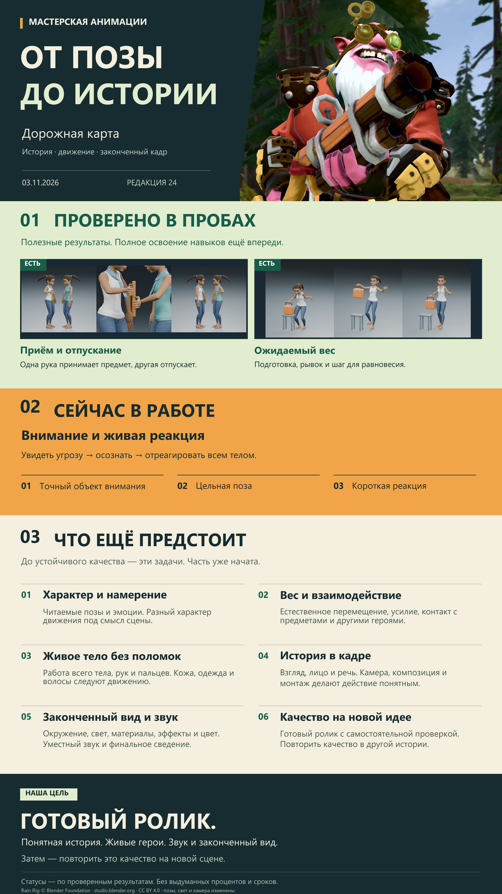

# Дорожная карта анимации



[PNG в полном размере](https://github.com/yotsug8/admiral8-renders/raw/refs/heads/renders/animation-roadmap.png).
Это обновляемый обзор от основ до принятого готового ролика, а не обещание
безошибочного исполнения любого промпта. Направления можно вести параллельно.
Три крупных раздела: светло-зелёный «Проверено в пробах» с кадрами полезных
проб, оранжевый «Сейчас в работе» и светлый «Что ещё предстоит».
Статус указан словами и цветом целого раздела. Пробы не означают,
что соответствующий навык полностью освоен.
Финальная цель отдельно помечена как ещё не достигнутая. Проценты и сроки не выдумываются.

Постер показывает только способности, необходимые для готового видео.
Технические ремонты, названия скриптов, количество проверок и перечень
всех исторических упражнений остаются в документации. В витрину попадают
результаты с понятной практической пользой, а не каждый завершённый тест.

## Обновление

После существенного проверенного результата:

1. Обновить технические доказательства в соответствующей карточке studies
   и очередь в PROJECT_STATE. Полный реестр — ANIMATION_BACKLOG.
2. Изменить только затронутые блоки `docs/animation_roadmap.json`:
   краткий результат, следующий шаг, evidence, дату и revision. Не повышать
   статус всего направления по одной пробе. JSON содержит и все 12 принципов;
   на постере они сгруппированы для читаемости. Читательский слой `poster`
   содержит текущую задачу и шесть крупных этапов; каждый ссылается на
   номера технических направлений в `blocks`. Обновлять его краткие
   формулировки вместе с изменением статусов; не превращать постер в журнал
   проверок. Подписи реальных кадров — `poster_title` и `poster_note`.
3. Собрать обе версии одной командой:

   ```powershell
   py -3.11 tools/animation_roadmap.py
   ```

   Вход — JSON и три изображения `roadmap-*` из ветки renders
   (по умолчанию `_game/renders_wt`, другой путь — `--assets`).
   PNG 1800×3200, самодостаточный SVG и хеши — `_game/study/roadmap/`.
   Нужны Pillow и шрифты
   Segoe UI, поставляемые Windows. На другой системе задать `--font` и
   `--bold-font` с кириллицей; шрифты не включаются в репозиторий.
4. Просмотреть постер: подписи, переносы, актуальность статусов и отсутствие
   личных данных. Генератор проверяет evidence, покрытие всех 12 направлений
   шестью этапами, вместимость абзацев и правую границу текста,
   но не подтверждает правдивость статуса автоматически.
5. Опубликовать PNG под прежним именем `animation-roadmap.png`, SVG и
   исходные иллюстрации в renders; код и данные — в main. В чате показывать
   PNG абсолютным локальным путём. Не создавать новую обложку при каждом
   обновлении статусов; текст и расположение задаются кодом.
6. Каждую изменённую и проверенную версию отправлять в отдельный чат
   готовых результатов: постер и краткая подпись с изменением, без логов
   и планов. Маршрут чата хранится локально в
   `_game/study/reporting_channel.json`, не в публичных инструкциях.

## Оформление и источники изображений

Редакция 21: первый пример — начало и завершение `rain_handoff_scene.mp4`
(кадры 0 и 179) и отдельно отрендеренный крупный хват кадра 85.
Сборка из трёх кадров без генеративной обработки — `roadmap-partner.jpg`
в renders. Метод и границы — [RAIN_HANDOFF.md](studies/RAIN_HANDOFF.md).
Статус всего направления контактов остаётся частичным.

Обложка — кадр на 1-й секунде существующего `probe4_look.mp4`,
отрендеренного в Blender. Генеративной иллюстрации в текущей карте нет.
Источник, время кадра и хеш записаны в
[ROADMAP_ART.json](studies/ROADMAP_ART.json).
В редакции 18 показаны реальные кадры `rain_intent_study.mp4`
(кадр 64, намерение) и две проверочные позы сцены `rain_effort_scene.mp4`
(кадр 150 в рабочем ракурсе и 239 сбоку, усилие и реакция).
Вторая пара воспроизводится через `study_rain_push.py --story --frames 150,239`.
Персонаж: **Rain Rig (CC) Blender Foundation | [studio.blender.org](https://studio.blender.org/characters/rain/v3/)**,
[CC BY 4.0](https://creativecommons.org/licenses/by/4.0/).
Постановка, позы, свет и камера изменены. Полный исходный кадр
вписывается в превью без обрезки; для обложки используется горизонтальный
фрагмент исходного кадра с персонажем. Обложка, цветовые поля и текст
собираются кодом, без генеративной графики.

Новый запуск не обращается к сети, не запускает Blender и не пересчитывает
учебные видео. Постер обновляется при выполнении работы; отдельный фоновый
планировщик для него не требуется и не настроен.
